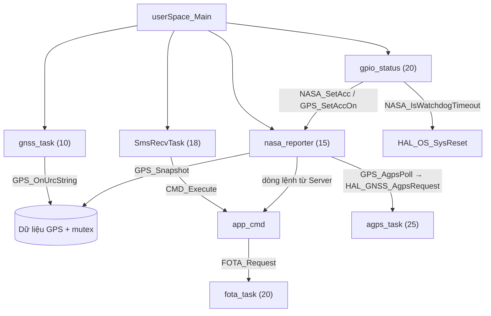
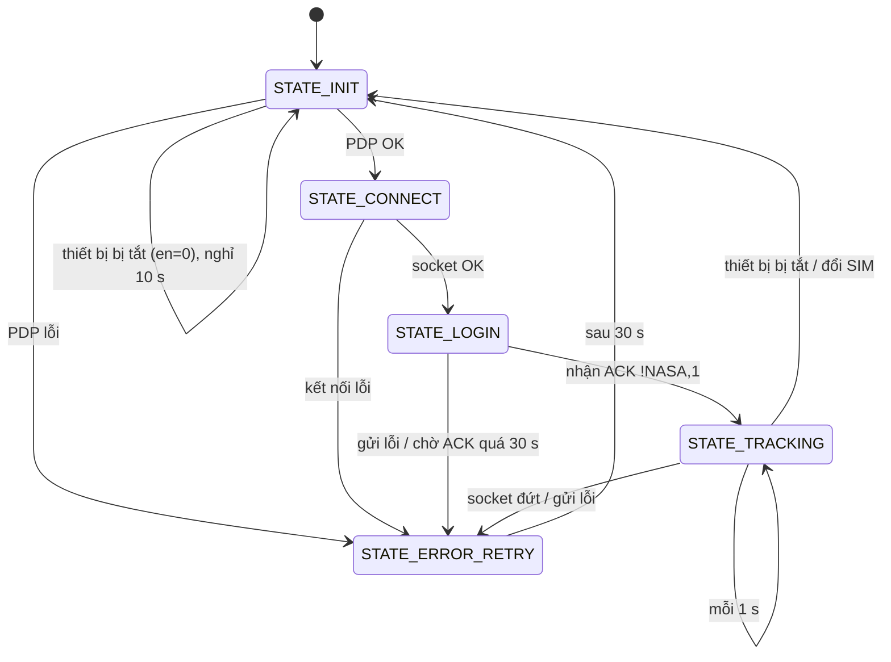
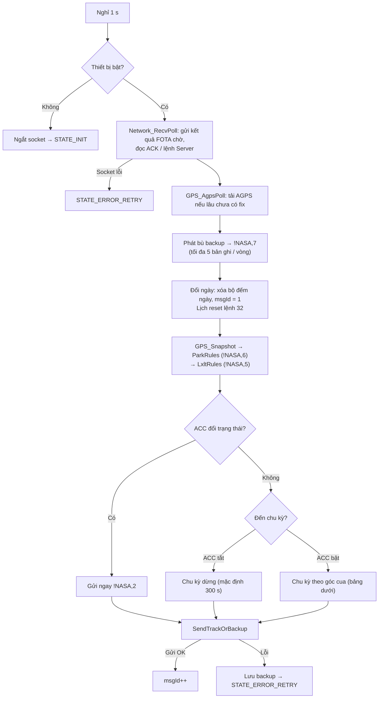

# Phân tích cấu trúc chương trình NASA Tracking (SIMCom A7677S)

Tài liệu mô tả chi tiết cấu trúc firmware giám sát hành trình chạy trên module 4G SIMCom **A7677S** (ASR1606, OpenSDK V702): các lớp, các task, máy trạng thái kết nối, luồng xử lý GPS, quy tắc nghiệp vụ, bộ đệm điểm mù và lệnh điều khiển. Phần tổng quan ngắn hơn nằm ở [README.md](README.md); lớp HAL có tài liệu riêng ở [hal/README.md](hal/README.md).

| Thông tin | Giá trị | Ở đâu |
|---|---|---|
| Tên thiết bị | `RV4G` | `NASA_DEVICE_NAME`, [app_config.h](app_config.h) |
| Phiên bản firmware | `v1.05.261014` (gửi trong bản tin đăng nhập, `sa,33`) | `NASA_FW_CODE`, [app_config.h](app_config.h) |
| Dòng log khởi động | `NASA_TRACKING VS1.00.261015` | [sc_application.c](sc_application.c) — đang khác `NASA_FW_CODE` |
| Phần cứng | `v1.0` | `NASA_HW_CODE` |
| Server mặc định | `103.57.209.16:2590` | `NASA_SERVER_HOST_DEFAULT`, `NASA_SERVER_PORT_DEFAULT` |
| Biến thể build | `A7677S_MANV_1606_V702_OPENSDK` | `.\GNUmake.exe A7677S_MANV_1606_V702_OPENSDK` (chạy trong cmd/PowerShell) |

---

## 1. Phân lớp

Code ứng dụng không gọi SDK SIMCom trực tiếp. Mọi truy cập phần cứng, mạng, hệ điều hành đi qua các hàm `HAL_*`; chỉ [hal/impl/hal_impl_simcom.c](hal/impl/hal_impl_simcom.c) được include `simcom_api.h`. Nhờ vậy hai bộ quy tắc nghiệp vụ (dừng đỗ, lái xe) chạy được unit test trên PC với HAL giả lập.

```text
┌────────────────────────────────────────────────────────────────────┐
│ ỨNG DỤNG    sc_application.c, app_*.c, drv_en25qh64a.c            │
│             (logic nghiệp vụ, giao thức !NASA, lệnh, bộ đệm)       │
├────────────────────────────────────────────────────────────────────┤
│ HAL         hal/hal_os.h  hal_net.h  hal_gnss.h  hal_gpio.h        │
│             hal_adc.h  hal_spi.h  hal_fs.h  hal_sms.h  hal_fota.h  │
│             hal_log.h                                              │
├────────────────────────────────────────────────────────────────────┤
│ CÀI ĐẶT     hal/impl/hal_impl_simcom.c  → gọi sAPI_* của SDK       │
├────────────────────────────────────────────────────────────────────┤
│ KERNEL      SIMCom OpenSDK (kernel/, sc_lib/) — chip GNSS          │
│             Unicorecomm bản trong nước (SC_DRIVER_GNSS_UNIC)       │
└────────────────────────────────────────────────────────────────────┘
```

---

## 2. Cây thư mục và vai trò từng file

```text
NASA-TRACKING-A7677S/
├── sc_application.c        Điểm vào userSpace_Main(): khởi tạo, tạo task nasa_reporter và SmsRecvTask
├── app_config.h            Toàn bộ hằng số: chu kỳ, ngưỡng, chân GPIO, GNSS, AGPS, FOTA, phiên bản
│
├── app_nasa.c / .h         Máy trạng thái kết nối & báo cáo, đóng gói bản tin !NASA, watchdog phần mềm
├── app_network.c / .h      PDP, socket TCP tới Server, gom dòng nhận về và phân loại (!NASA / lệnh)
├── app_gps.c / .h          Phân tích URC GNSS, lọc chạy/dừng, điểm neo khi đứng yên, odometer, AGPS, log debug
├── app_park_rules.c / .h   Quy tắc dừng đỗ → bản tin !NASA,6 (C thuần, có unit test)
├── app_lxlt_rules.c / .h   Quy tắc phiên lái / lái xe liên tục → bản tin !NASA,5 (C thuần, có unit test)
├── app_cmd.c / .h          Phân tích & thực thi lệnh na,<mã>,... / sa,<mã> từ SMS hoặc Server
├── app_sms.c / .h          Cấu hình modem SMS, tách số gửi + nội dung, chuyển cho app_cmd, trả lời SMS
├── app_cfg.c / .h          Cấu hình thiết bị: flash (sector 0/1) + file C:/rv26.cfg
├── app_backup.c / .h       Bộ đệm điểm mù: vòng bản ghi trên flash rời, dự phòng file C:/rv26_bak.dat
├── app_fota.c / .h         Cập nhật firmware từ URL (lệnh 33), task fota_task
├── app_sim.c / .h          Phát hiện rút / cắm / đổi SIM bằng cách hỏi định kỳ
├── app_indication.c / .h   Task gpio_status: lọc ACC, LED, DOUT, giám sát watchdog
├── app_utils.c / .h        Tick, định dạng ngày giờ, task ntp_sync
├── drv_en25qh64a.c / .h    Driver flash SPI 8 MB (W25Q64JV / EN25QH64A), tự dò kênh SPI
│
├── hal/                    Giao diện HAL (*.h) + README
│   └── impl/hal_impl_simcom.c   Cài đặt duy nhất gọi sAPI_*; có task gnss_task và agps_task
│
├── tests/                  Unit test chạy trên PC (CMake)
│   ├── mocks/              HAL giả lập: os, net, gnss, gpio, adc
│   └── unit/               test_park_rules.c, test_lxlt_rules.c
│
└── out/A7677S_MANV_1606_V702_OPENSDK/   Kết quả build: customer_app.bin (FOTA), burn.zip (nạp cáp)
```

---

## 3. Khởi động

`userSpace_Main()` ([sc_application.c](sc_application.c)) chạy một lần theo thứ tự:

| Bước | Hàm | Việc làm |
|---|---|---|
| 1 | `ApiMapInit()` | Nạp bảng hàm SDK |
| 2 | `HAL_OS_TaskSleep(5 s)` | Chờ modem ổn định (`APP_STARTUP_DELAY_SEC`) |
| 3 | `EN25_Init()` | Dò flash rời trên các kênh SPI, đọc mã chip |
| 4 | `CFG_Init()` | Nạp cấu hình: flash sector 0 → sector 1 → file `C:/rv26.cfg` → mặc định |
| 5 | `GPS_Init()` | Tạo mutex dữ liệu GPS |
| 6 | `SMS_Init()` | Cấu hình modem SMS |
| 7 | `HAL_NET_Init()`, `HAL_NET_NitzEnable()` | Khởi tạo mạng, bật nhận giờ từ nhà mạng (NITZ) |
| 8 | `HAL_GNSS_SetMode(CFG_GetGnssMode())`, `HAL_GNSS_SetStaticHold(100)` | Ghi nhớ hệ vệ tinh (lệnh 3) và ngưỡng giữ tĩnh để áp dụng khi bật GNSS |
| 9 | `HAL_GNSS_UrcListenerStart()` | Tạo `gnss_task`: bật GNSS, khởi động nóng, đặt chế độ, gửi `$CFGDYN`, bật URC 1 giây |
| 10 | `INDICATION_TaskStart()` | Tạo `gpio_status` |
| 11 | Tạo `nasa_reporter`, `SmsRecvTask` | Hai task nghiệp vụ chính |

---

## 4. Các task

| Task | Ưu tiên | Stack | Tạo ở | Chu kỳ / kích hoạt | Công việc |
|---|---|---|---|---|---|
| `gnss_task` | 10 | 4 KB | [hal_impl_simcom.c](hal/impl/hal_impl_simcom.c) | Mỗi URC (1 giây) | Nhận `+CGNSSINFO`, gọi `GPS_OnUrcString()` |
| `nasa_reporter` | 15 | 10 KB | [sc_application.c](sc_application.c) | Lặp liên tục, nghỉ 1 giây mỗi vòng TRACKING | `NASA_RunStep()`: kết nối, đăng nhập, gửi bản tin, phát bù, quy tắc |
| `SmsRecvTask` | 18 | 8 KB | [sc_application.c](sc_application.c) | Chờ URC SMS (timeout 1 giây) | Đọc SMS → thực thi lệnh → xóa SMS; gọi `SIM_Poll()` |
| `gpio_status` | 20 | 4 KB | [app_indication.c](app_indication.c) | 0,5 giây (100 tick, 200 tick/giây) | Lọc ACC, LED, DOUT, kiểm tra watchdog |
| `fota_task` | 20 | 10 KB | [app_fota.c](app_fota.c) | Chỉ tạo khi có lệnh 33 | Tải và nạp firmware |
| `agps_task` | 25 | 4 KB | [hal_impl_simcom.c](hal/impl/hal_impl_simcom.c) | Chỉ tạo khi có yêu cầu AGPS đầu tiên | Gọi `sAPI_GnssAgpsSeviceOpen()` |
| `ntp_sync` | 130 | — | [app_utils.c](app_utils.c) | Chỉ tạo khi RTC chưa hợp lệ | Hiện **chưa đồng bộ thật** (chỉ in log) |

Quy ước dùng chung:

- Chỉ `nasa_reporter` ghi vào socket Server. Task khác muốn gửi lên Server phải để lại dữ liệu cho task này lấy (ví dụ `FOTA_TakeServerResult()`).
- Dữ liệu GPS dùng chung giữa `gnss_task` và các task khác được bảo vệ bằng mutex `s_gpsDataMutex`; luôn đọc qua `GPS_Snapshot()`.
- Cấu hình bảo vệ bằng mutex trong `app_cfg.c`; thay đổi được ghi xuống bộ nhớ trong vòng 10 giây (`CFG_FlushDirty()`).



---

## 5. Máy trạng thái `NASA_RunStep()`

[app_nasa.c](app_nasa.c). Mỗi lần gọi: nuôi watchdog, áp dụng đổi SIM nếu có, kiểm tra mất kết nối 15 phút, ghi cấu hình bẩn (mỗi 10 giây), rồi chạy trạng thái hiện tại.



| Trạng thái | Hàm | Việc làm | Khi chưa có phiên |
|---|---|---|---|
| `STATE_INIT` | `Handle_StateInit` | Kích hoạt PDP; gọi `TriggerNtpSyncIfNeeded()` | `OfflineSample()` |
| `STATE_CONNECT` | `Handle_StateConnect` | Mở socket tới `CFG_GetServerHost():Port` | `OfflineSample()` |
| `STATE_LOGIN` | `Handle_StateLogin` | Gửi `!NASA,1`, chờ ACK tối đa 30 s (`NASA_LOGIN_ACK_TIMEOUT_SEC`) | `OfflineSample()` mỗi giây |
| `STATE_TRACKING` | `Handle_StateTracking` | Xem mục 6 | — |
| `STATE_ERROR_RETRY` | trong `NASA_RunStep` | Ngắt socket, chờ 30 s (`ERROR_RETRY_DELAY_SEC`) | `OfflineSample()` mỗi giây |

`OfflineSample()` giữ hành trình liền mạch khi chưa có phiên: chạy quy tắc dừng đỗ / lái xe và ghi vị trí vào bộ đệm điểm mù theo cùng chu kỳ như lúc gửi trực tiếp.

---

## 6. Vòng `STATE_TRACKING`



Chu kỳ gửi khi ACC bật (`GetAdaptivePeriodSec`):

| Điều kiện | Chu kỳ |
|---|---|
| Tốc độ dưới 8 km/h, hoặc chưa có hướng trước | Chu kỳ chạy (mặc định 10 s) |
| Đổi hướng ≥ 30° so với bản tin trước | 2 s |
| Đổi hướng ≥ 15° | 50% chu kỳ chạy, tối thiểu 5 s |
| Còn lại | Chu kỳ chạy |

"ACC bật" ở đây là `IsAccOn()` theo chế độ lệnh 8: 0 = chỉ theo tốc độ GPS, 1 = chỉ theo dây ACC (mặc định), 2 = dây hoặc tốc độ.

---

## 7. Giao thức `!NASA`

Mỗi bản tin kết thúc bằng `*<checksum>` rồi `\r` (bản tin đăng nhập kết thúc bằng `\r\n`). `msgId` tăng sau mỗi bản tin gửi thành công và về 1 khi đổi ngày.

| Mã | Ý nghĩa | Định dạng (trước `*checksum`) |
|---|---|---|
| `!NASA,1` | Đăng nhập | `msgId, ngày giờ, IMEI, ICCID, biển số, HW, FW, mã đăng nhập, lý do reset` |
| `!NASA,2` | Vị trí định kỳ | `msgId, ngày giờ, lat, lon, tốc độ, trạng thái, CSQ, số vệ tinh, km trong ngày (đơn vị 10 m), hướng, điện áp, 0,0,0,` |
| `!NASA,5` | Phiên lái xe (5-1 / 5-2 / 5-3) | `msgId, ngày giờ, loại, tên lái xe, GPLX, giờ + vị trí đăng nhập, phút lái liên tục, phút lái trong ngày, [giờ + vị trí đăng xuất], số lần quá 4 giờ, quãng đường (m)` |
| `!NASA,6` | Dừng đỗ (6-1 / 6-2 / 6-3) | `msgId, ngày giờ, tên lái xe, GPLX, giờ bắt đầu đỗ, loại, giờ kết thúc, lat, lon, số giây đỗ, số lần đỗ trong ngày` |
| `!NASA,7` | Phát bù từ backup | Như `!NASA,2`, ngày giờ là lúc ghi bản ghi |

Trả lời lệnh từ Server không phải bản tin `!NASA`: `ServerCmdReply()` ([app_network.c](app_network.c)) gửi nguyên câu trả lời của `app_cmd` kèm `\r\n` (ví dụ `sa,2 dieu khien ra: bat`).

Bit trạng thái (`BuildDeviceStatus`, [app_config.h](app_config.h) `ST_*`):

| Bit | Ý nghĩa | Bit | Ý nghĩa |
|---|---|---|---|
| 0 | GPS có fix | 6 | Vượt 120 km/h |
| 1 | Flash rời OK | 7 | Lái liên tục quá 4 giờ |
| 2 | ACC bật (theo lệnh 8) | 8 | Ắc-quy ≥ 10,5 V |
| 5 | Lái xe đã đăng nhập | 3, 4, 9–12 | Chưa dùng (cửa, điều hòa, nhiên liệu, nhiệt độ, SOS) |

Điện áp: `NASA_GetVoltage()` đọc ADC1, nhân 23 (cầu chia 220 kΩ / 10 kΩ); đọc lỗi thì dùng 12,0 V.

---

## 8. Luồng GPS ([app_gps.c](app_gps.c))

Mỗi giây `gnss_task` đưa một dòng `+CGNSSINFO` vào `GPS_OnUrcString()`. Thứ tự xử lý:

1. **Đọc dòng URC thành một mẫu** (`GnssSample_t`): `TryParseCgnssInfoUrc` (chính) hoặc `TryParseCgpsInfoUrc`. Lấy vĩ độ, kinh độ, tốc độ, hướng, giờ UTC, HDOP (trường thứ 9 sau N/S), số vệ tinh = tổng các hệ (GPS + GLONASS + GALILEO + BEIDOU). Dòng không phải hai dạng này chỉ được dò giờ UTC, không lấy tọa độ. Mọi mẫu đi qua một hàm duy nhất `ApplySample()` (dòng "không có fix" qua `ApplyNoFix()`), hàm này làm các bước 2–5 dưới đây.
2. **Lọc chạy / dừng** (`FilterMovingStatus`): tốc độ trên ngưỡng (mặc định 3 km/h, lệnh 10) liên tục 3 s mới là chạy; dưới ngưỡng 10 s là dừng; theo dõi trạng thái đỗ và trôi sau khi tắt ACC (bảng dưới).
3. **Odometer** (`UpdateOdometer`): chỉ cộng khi đang chạy; bỏ bước nhảy dài hơn tốc độ cho phép trong thời gian đã trôi; mất GPS dưới 30 s (`ODOM_GPS_LOSS_TIMEOUT_SEC`) thì khi có lại nối từ điểm tham chiếu cũ, quá 30 s thì bỏ điểm tham chiếu (log một lần).
4. **Điểm neo khi đứng yên** (`ApplyStationaryAnchor`): vị trí gửi đi khi dừng / đỗ là trung bình các mẫu tốt.
5. **Log debug** (`GpsDebugOnSample`, bật bằng `GNSS_DEBUG`).

Trạng thái đỗ theo `accMode` (lệnh 8):

| accMode | Vào đỗ | Thoát đỗ |
|---|---|---|
| 0 | Dừng liên tục 600 s | Chạy trên ngưỡng 3 s và đã rời điểm neo ≥ 15 m |
| 1 (mặc định) | ACC tắt và tốc độ ≤ ngưỡng (đang trôi thì chờ); dự phòng 600 s | Như trên; nếu ACC vẫn tắt thì phải rời điểm neo ≥ 150 m (kéo / chở xe) |
| 2 | Như 1 | Như 1 |

Điểm neo:

| Quy tắc | Giá trị | Hằng số |
|---|---|---|
| Neo khi | Đang đỗ, hoặc đã dừng (không chạy) và không trong lúc trôi sau tắt ACC | — |
| Mẫu được gộp | HDOP ≤ 2,5 (HDOP không có thì coi là tốt) | `ANCHOR_MAX_HDOP` |
| Bỏ mẫu xa | Cách trung bình > 25 m, sau 10 mẫu đầu | `ANCHOR_OUTLIER_KM`, `ANCHOR_MIN_SAMPLES_FOR_REJECT` |
| Làm lại điểm neo | 30 mẫu tốt liên tiếp bị bỏ | `ANCHOR_RESTART_REJECTS` |
| Cố định | Sau 900 mẫu (15 phút) | `ANCHOR_MAX_SAMPLES` |

Cấu hình chip GNSS (theo *A76xx Series Open SDK GNSS Application Note V1.02*):

| Mục | Cách làm | Ghi chú |
|---|---|---|
| Bật nguồn | `sAPI_GnssPowerStatusSet(ON)` đúng một lần | Bật 2 lần làm hỏng nạp động |
| Khởi động nóng | `sAPI_GnssStartMode(SC_GNSS_START_HOT)` | |
| Hệ vệ tinh | `sAPI_GnssModeSet`, lệnh 3: 1 GPS+BDS+QZSS (mặc định), 2 BDS, 3 GPS+QZSS | Bản trong nước không có Galileo / GLONASS |
| Giữ tĩnh | `$CFGDYN,h02,1,100`: tốc độ < 100 cm/s thì chip giữ vị trí | Chip UC6228CI không lưu lệnh này, gửi lại mỗi lần bật |
| AGPS | `GPS_AgpsPoll()`: có phiên Server, chưa fix sau 60 s, giờ hợp lệ, cách lần trước ≥ 2 giờ → `agps_task` | Nhà sản xuất khuyến cáo ≤ 12 lần/ngày |
| URC | `sAPI_GnssInfoGet(1)` | `+CGNSSINFO` mỗi giây |

`GPS_Snapshot()` trả bản sao dữ liệu; khi mất GPS nó giữ vị trí hợp lệ cuối với `valid = 0`, chưa từng có fix thì là 0,0.

---

## 9. Quy tắc nghiệp vụ (C thuần)

Hai module chỉ nhận dữ liệu qua tham số (snapshot GPS, tick, giờ), không gọi HAL, nên có unit test ở [tests/unit/](tests/unit/).

**Dừng đỗ** ([app_park_rules.c](app_park_rules.c), bản tin 6):

| Sự kiện | Khi nào |
|---|---|
| 6-1 | Xe chuyển sang đỗ |
| 6-2 | Đang đỗ, mỗi `parkConfirmSec` giây (lệnh 26, mặc định 60, tối đa 900) |
| 6-3 | Xe chạy lại; không sớm hơn 5 s sau 6-1 (`PARK_FRAME_GUARD_SEC`) |

**Phiên lái xe** ([app_lxlt_rules.c](app_lxlt_rules.c), bản tin 5):

| Sự kiện | Khi nào |
|---|---|
| 5-1 | Xe bắt đầu chạy (mở phiên) |
| 5-2 | Mỗi 60 s trong phiên (`WORK_PERIODIC_SEC`) |
| 5-3 | Dừng ≥ 15 phút (`WORK_LOGOUT_STOP_SEC`); giờ / vị trí đăng xuất là lúc xe bắt đầu dừng; 15 phút chờ không tính vào thời gian lái |
| Bit 7 | Lái liên tục quá 240 phút (`WORK_LXLT_LIMIT_MIN`) |

Bản tin 5 và 6 phát sinh khi chưa có phiên Server bị bỏ (không lưu backup); trạng thái vẫn được cập nhật nên bản tin kế tiếp đúng.

---

## 10. Bộ đệm điểm mù ([app_backup.c](app_backup.c))

Bố cục flash rời (sector 4 KB):

| Sector | Nội dung |
|---|---|
| 0, 1 | Cấu hình (bản chính, bản sao) — [app_cfg.c](app_cfg.c) |
| 2, 3 | Nhật ký header hàng đợi, 256 ô, dùng luân phiên |
| 4 trở đi | Vòng bản ghi 128 byte (32 ô / sector), 65.408 ô |

| Cơ chế | Chi tiết |
|---|---|
| Bản ghi | Dữ liệu vị trí + số thứ tự + CRC32 (`FLASH_SLOT_MAGIC` = `REC1`) |
| Ghi | Kiểm ô trống trước, đọc lại so sau; ô hỏng bỏ qua, tối đa 3 ô liên tiếp rồi bỏ bản ghi |
| Header | Lưu sau mỗi 16 bản ghi và sau mỗi lượt phát bù; khởi động thì dò tiếp theo số thứ tự |
| Đầy vòng | Xóa sector cũ nhất (32 ô) |
| Phát bù | `ReplayBurst`: tối đa 5 bản ghi / vòng TRACKING, chỉ xóa khỏi hàng đợi sau khi gửi được |
| Bỏ bản ghi | Không có giờ / vị trí hợp lệ, hoặc sai CRC |
| Dự phòng | Không có flash: file `C:/rv26_bak.dat`, tối đa 2.000 ô, header lưu sau mỗi bản ghi |
| Trạng thái | `Backup_GetStatus` (lệnh 29: `FL BK ERR`), `Backup_GetMedia` (LED nguồn) |

---

## 11. Ngõ vào / ngõ ra ([app_indication.c](app_indication.c))

| Tín hiệu | Pad | Xử lý |
|---|---|---|
| ACC_IN | 37 (GPIO_10, pin 66) | Mức thấp = bật; đổi trạng thái sau 6 chu kỳ ổn định (~3 s); đọc lỗi thì giữ trạng thái cũ và log |
| DOUT | 28 (GPIO_09, pin 52) | Theo cấu hình lệnh 2, ghi lại mỗi chu kỳ |
| LED GNSS | 74 | Nháy khi ≥ 5 vệ tinh, sáng khi ít hơn |
| LED mạng | 80 | Nháy = đã đăng nhập Server; sáng = có sóng; tắt = mất sóng |
| LED nguồn | 32 | Nháy = backup trên flash rời; sáng = file trong module; tắt = không lưu được |
| CS flash | 120 (GPIO_05, pin 19) | Qua transistor đảo; driver tự lái |

Chế độ im lặng (lệnh 11) tắt cả 3 LED. Mỗi chu kỳ task cũng kiểm tra `NASA_IsWatchdogTimeout()`.

---

## 12. Lệnh điều khiển ([app_cmd.c](app_cmd.c))

Lệnh đến từ SMS ([app_sms.c](app_sms.c)) hoặc Server ([app_network.c](app_network.c)) đều vào `CMD_Execute()`. `na,<mã>,...` để đặt, `sa,<mã>` để đọc; trả lời về đúng nguồn (SMS về số gửi, Server bằng một dòng văn bản trên cùng socket). Lệnh cũ `reset` / `reset#` và `update,...` vẫn được nhận.

| Mã | Chức năng | Ví dụ |
|---|---|---|
| 1 | IP và cổng Server | `na,1,103.57.209.16,2590` |
| 2 | Ngõ ra DOUT | `na,2,1` / `na,2,0` |
| 3 | Hệ vệ tinh | `na,3,1` (GPS+BDS+QZSS), `2` (BDS), `3` (GPS+QZSS) |
| 4 | Chu kỳ gửi chạy / dừng (5–3600 s) | `na,4,10,300` |
| 8 | Chế độ ACC | `na,8,0|1|2` |
| 9 | Khởi động lại | `na,9` |
| 10 | Ngưỡng tốc độ chạy / dừng | `na,10,3` |
| 11 | Chế độ im lặng | `na,11,1` |
| 12 | Phát lại dữ liệu cũ | `na,12,<từ>,<đến>` |
| 14 | Đăng nhập / đăng xuất lái xe (đảo trạng thái) | `na,14` |
| 17, 18 | Số điện thoại chủ xe 1, 2 | `na,17,<số>` |
| 25 | Tên lái xe, GPLX | `na,25,<tên>,<GPLX>` |
| 26 | Chu kỳ báo dừng đỗ 6-2 | `na,26,60` |
| 27 | Vị trí hiện tại (link Google Maps) | `sa,27` |
| 29 | Thông tin thiết bị | `sa,29` → `RV4G <IMEI> <ICCID> GSM GPS server port kết nối ACC FL BK ERR SIM` |
| 32 | Lịch tự reset | `na,32,<số ngày>,<giờ>` |
| 33 | Cập nhật firmware / đọc phiên bản | `na,33,<URL>` / `sa,33` |
| 34 | Xóa backup | `na,34` |
| 35 | Xóa toàn bộ dữ liệu | `na,35` |
| 37 | Gửi SMS hộ | `na,37,<số>,<nội dung>` |
| 40 | Khóa / mở khóa cấu hình | `na,40,close|open` — hiện luôn mở (`NASA_LOCK_FEATURE_ENABLE = 0`) |
| 41 | Khôi phục cài đặt gốc | `na,41` |

---

## 13. Cấu hình ([app_cfg.c](app_cfg.c))

Cấu hình (`AppConfig_t`) lưu ở hai nơi mỗi lần `CFG_Save()`:

1. Flash rời sector 0 và 1: cả struct + CRC (`CFG_FLASH_MAGIC` = `NASA`).
2. File `C:/rv26.cfg` dạng `key=value`: `host port plate pmove pstop acc spdth silent dout ph1 ph2 ph3 park rsd rsh lock en days dname dlic dlog lmday gnss`.

Khi nạp, flash được ưu tiên; nếu cả hai sector sai CRC (ví dụ struct vừa thêm trường như `gnssMode`) thì đọc file, file cũng không có thì dùng mặc định.

---

## 14. Cập nhật firmware ([app_fota.c](app_fota.c))

| Tên file cuối URL | Loại | Cách nạp |
|---|---|---|
| `customer_app.bin` | Ứng dụng | App tự tải (HTTP / HTTPS / FTP), kiểm CRC, reset để bootloader nạp |
| Tên khác | Hệ thống (gói vi sai `adiff.exe`) | SDK tải, đạt 100% thì reset; không có tiến triển 20 phút thì báo lỗi |

Thử lại tối đa 3 lần, cách 10 s. Kết quả báo về nguồn gửi lệnh; lỗi thì firmware đang chạy giữ nguyên.

---

## 15. Tự phục hồi

| Điều kiện | Hành động | Ở đâu |
|---|---|---|
| `nasa_reporter` không nuôi watchdog 180 s | Reset | `gpio_status` |
| Mất phiên Server liên tục 15 phút | Reset | `CheckNetworkDisconnTimeout` |
| Đến giờ lịch reset (lệnh 32) | Reset | `Handle_StateTracking` |
| `abort()` | Reset | [sc_application.c](sc_application.c) |
| SIM không sẵn sàng 2 lần hỏi (mỗi 5 s), quá 30 s | Tắt / bật sóng (CFUN 0/1) mỗi 60 s | [app_sim.c](app_sim.c) |
| SIM sẵn sàng lại hoặc đổi ICCID | Cấu hình lại SMS, đăng nhập lại với ICCID mới | `NASA_OnSimChanged` |

---

## 16. Hạn chế đã biết

| Vấn đề | Ảnh hưởng |
|---|---|
| `ntp_sync` không gọi hàm đồng bộ nào | Không có NITZ thì chỉ có giờ sau khi GPS fix; AGPS bị bỏ qua trong lúc đó |
| Lịch reset (lệnh 32) bỏ qua số ngày và có thể reset lặp trong phút `<giờ>:00` | Reset mỗi ngày thay vì mỗi N ngày |
| Khóa cấu hình tắt cứng | Bất kỳ số nào cũng gửi được lệnh đổi server, FOTA, xóa dữ liệu, lệnh 37 |
| Bản tin 5 / 6 khi mất mạng bị bỏ | Server thiếu sự kiện lái xe / đỗ trong điểm mù |
| Nơi lưu backup chỉ chọn lúc khởi động | Flash hỏng khi đang chạy thì dữ liệu mất (LED nguồn tắt) |
| `NASA_FW_CODE` (`v1.05.261014`) khác dòng log khởi động (`VS1.00.261015`) | Dễ nhầm phiên bản khi đối chiếu |
